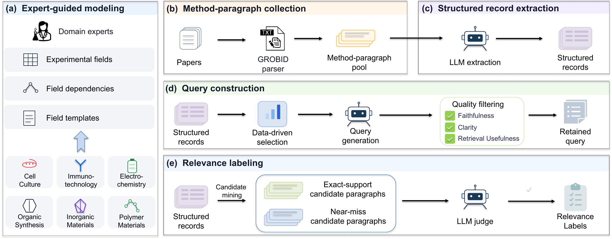
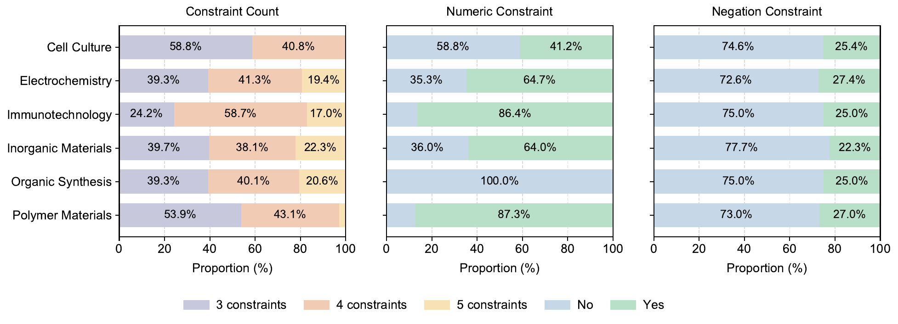

# ProSearch

Official code and data resources for:

**ProSearch: Benchmarking Multi-Constraint Protocol Retrieval in Experimental Science**

ProSearch evaluates whether retrieval systems can find experimental
protocol paragraphs that satisfy multiple interdependent constraints within
one coherent experimental setup.

- Dataset: https://huggingface.co/datasets/kg4sci/ProSearch
- Benchmark size: 1,515 queries across six domains
- Main retrieval unit: method paragraph
- Additional setting: full paragraph pool for full-text retrieval analysis

## Dataset construction

ProSearch is constructed by combining expert-guided schema design,
method-paragraph collection, structured protocol extraction, query
generation, candidate mining, and evidence-grounded relevance labeling.



[Download PDF](scripts/assets/data_construction.pdf)

## Dataset

The released benchmark is available from Hugging Face:

```bash
git clone https://huggingface.co/datasets/kg4sci/ProSearch
```

The benchmark contains six scientific domains. Each domain provides the
following files:

```text
paragraphs.json       # method-paragraph candidate pool
all_paragraphs.json   # full paragraph candidate pool
queries_raw.json      # released queries
qrels_stage1.json     # query--paragraph relevance labels
```

`paragraphs.json` is the method candidate pool used for the main benchmark.
`all_paragraphs.json` supports retrieval over the full paragraph pool.

The released benchmark contains 1,515 queries in total.



[Download PDF](scripts/assets/query_composition.pdf)

## Repository layout

The repository is organized by construction, retrieval, and analysis stage:

```text
.
├── scripts/
│   ├── process_pdf/            # Article download, PDF parsing, and paragraph construction
│   ├── structured_extraction/  # Setup-level protocol extraction and cleaning
│   ├── constraint_set/         # Constraint schemas, templates, and sampling
│   ├── gen_query/              # Query generation and query variants
│   ├── stage1_relevance/       # Candidate-pool construction and boundary analysis
│   ├── relevance/              # Relevance judgment and qrels construction
│   ├── eval/                   # Dense retrieval and metric evaluation
│   ├── reranker/               # Reranking experiments
│   ├── agentic/                # Open-world retrieval baselines
│   ├── analysis/               # Retrieval and pool-coverage analyses
│   ├── manual_audit/           # Manual query and label audits
│   └── assets/                 # README figures
├── README.md
└── LICENSE-CODE
```

## Using the benchmark

To run retrieval experiments, place the downloaded domain files in the
working layout expected by the original scripts, or edit the paths in
`scripts/eval/run_dense.sh` and `scripts/eval/eval.sh` directly.

The original layout is:

```text
seed_data/{domain}/paragraphs.json
seed_data/{domain}/all_paragraphs.json
data/{domain}/gen_query/queries_raw.json
data/{domain}/stage1_relevance/qrels_stage1.json
data/{domain}/eval/
```

The scripts use this layout for retrieval runs, embeddings, query variants,
and evaluation outputs under `data/{domain}/`.

## Evaluation

### Main method-paragraph retrieval

Edit `scripts/eval/run_dense.sh` before running it:

1. Set `DOMAINS` to the domains to evaluate.
2. Select models in `MODELS`.
3. Select the query input in `TYPES` (for the original query, use
   `raw`).
4. Set `DEVICE`, model paths, corpus paths, and output paths.
5. Run the script from the project root.

```bash
bash scripts/eval/run_dense.sh
```

This script calls `scripts/eval/run_dense.py` to encode the corpus and queries,
produce top-(k) runs, and save JSON/TREC retrieval results.

To calculate nDCG@10 and other metrics, configure `scripts/eval/eval.sh`:

```bash
bash scripts/eval/eval.sh
```

The evaluation script reads the query metadata, qrels, and retrieval runs,
then writes a CSV summary. Set `DOMAIN_LIST`, `MODEL_LIST`, `TYPE`,
`METRICS`, and the three relative paths in `scripts/eval/eval.sh` to match the
local layout.

### Full-text retrieval analysis

From the repository root, use `bash scripts/eval/run_dense_all.sh`. Before
running it, update:

- `DOMAINS`;
- `QUERIES_PATH` for the corresponding domain;
- `CORPUS_PATH` to `all_paragraphs.json`;
- output and embedding-cache paths.

For the released files, set the corpus path to:

```text
seed_data/{domain}/all_paragraphs.json
```

and use the corresponding query file and qrels under `data/{domain}/`.

The script then calls the same `scripts/eval/run_dense.py` entry point with the
full paragraph pool. The only intended change between the main and
full-text settings is the candidate paragraph pool.

## Reproducing dataset construction

To rebuild the dataset from source articles, run the following stages in
order. Each stage should be completed and its outputs preserved before
starting the next one:

This is a staged reconstruction workflow rather than a one-command rebuild.

1. **Article selection and full-text acquisition.** Manually screen the
   OpenAlex records for the target domain, collect the resulting DOI list,
   and use `scripts/process_pdf/download_pdf.py` to query open-access links through
   Unpaywall and download available PDFs.
2. **PDF parsing and paragraph construction.** Run a local GROBID service
   and execute `scripts/process_pdf/process_by_grobid.py`. The conversion utilities in
   `scripts/process_pdf/` produce TEI, text, sentence, and paragraph-level outputs.
3. **Protocol-record extraction.** Configure the LLM/API used for extraction,
   then use `scripts/structured_extraction/` to identify setup-level experimental
   records and normalize their fields. `llm_extract.sh` and `llm_clean.sh`
   are the main entry points.
4. **Constraint and query construction.** Use `scripts/constraint_set/` to derive
   field dependencies, field-template combinations, and constraint
   instantiations. Configure the query-generation model, then use
   `sample_final_constraints.py` to select constraint sets and
   `scripts/gen_query/gen_query.sh` to generate and filter natural-language queries.
5. **Candidate mining and relevance labeling.** Use `scripts/stage1_relevance/` and
   `scripts/relevance/` to construct exact-support and near-miss candidate pools.
   Configure the judging model, obtain evidence-grounded judgments, and
   create `qrels_stage1.json` with `build_qrels_from_judgment.py`.

The corresponding code is organized as follows:

| Stage                            | Directory                  | Representative entry points                                             |
| -------------------------------- | -------------------------- | ----------------------------------------------------------------------- |
| Article and paragraph processing | `scripts/process_pdf/`           | `process_by_grobid.py`, paragraph conversion scripts                  |
| Protocol extraction              | `scripts/structured_extraction/` | `llm_extract.sh`, `llm_clean.sh`                                    |
| Constraint construction          | `scripts/constraint_set/`        | `get_field_template_combinations.py`, `sample_final_constraints.py` |
| Query generation                 | `scripts/gen_query/`             | `gen_query.sh`, `gen_query.py`                                      |
| Candidate-pool preparation       | `scripts/stage1_relevance/`      | boundary and sample-building scripts                                    |
| Relevance labeling               | `scripts/relevance/`             | `judge.sh`, `build_qrels_from_judgment.py`                          |
| Retrieval and evaluation         | `scripts/eval/`                  | `run_dense.py`, `eval.py`                                           |

## Limitations

While ProSearch provides a systematic evaluation of multi-constraint protocol
retrieval, several limitations remain. First, the field schemas and
constraint rules are designed by domain experts for selected experimental
protocol types across six domains, limiting coverage of other experimental
procedures and requiring additional expert effort for extension. Second,
ProSearch focuses on individual method paragraphs and does not evaluate
evidence integration across multiple paragraphs, tables, or supplementary
materials. Third, LLM-based protocol extraction and relevance labeling,
together with annotation pools constructed from extracted records, may
introduce errors or omit relevant evidence. Although expert audits and
robustness analyses support the stability of the main retrieval findings,
systematic biases cannot be fully ruled out. Finally, while the queries are
grounded in real experimental records, they are generated using templates and
may not fully reflect researchers' actual information needs. Whether benchmark
scores translate into retrieval usefulness in real scientific workflows also
remains to be established. Future work will extend ProSearch to cross-
paragraph protocol retrieval and incorporate researcher-authored queries and
human evaluations to assess its practical applicability.

## Citation

If you use ProSearch, please cite:

```text
ProSearch: Benchmarking Multi-Constraint Protocol Retrieval in
Experimental Science.
```

## License

The ProSearch dataset is released under the
[Creative Commons Attribution 4.0 International (CC BY 4.0)](https://creativecommons.org/licenses/by/4.0/) license.

The accompanying code is released under the
[MIT License](LICENSE-CODE).
